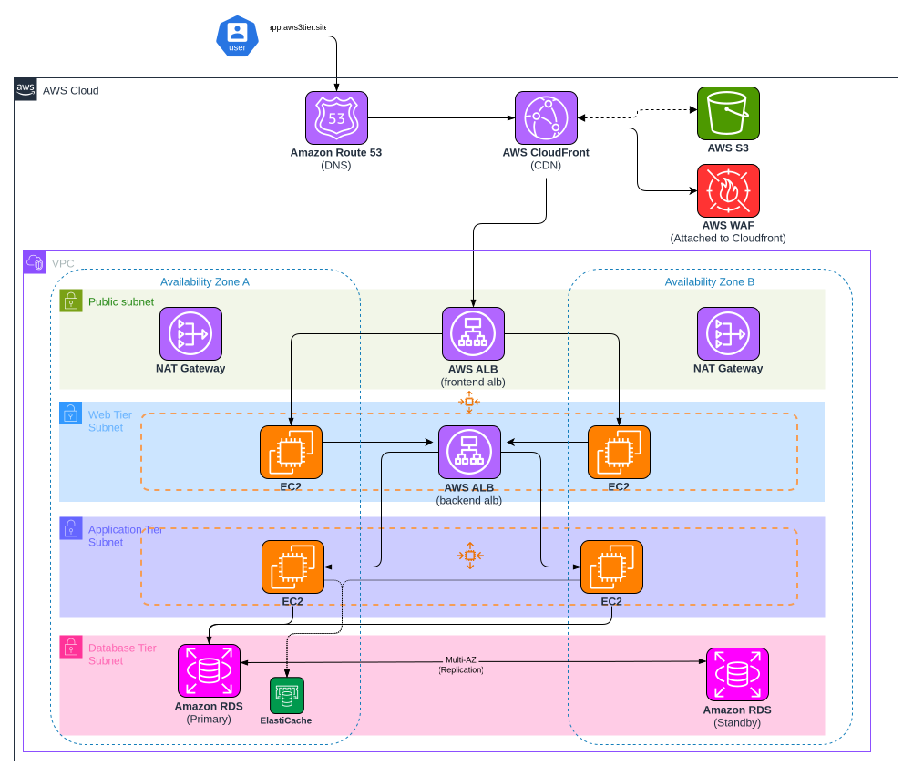

# Secure 3-Tier Web Application on AWS with Terraform


> **⚠️ Project Status: Active Development**  
> This project is currently in the active development phase. The `DEV` environment is fully configured and ready for deployment. The `PROD` environment will be added in future updates.

This project automatically builds a complete, secure, and scalable 3-tier web application infrastructure on Amazon Web Services (AWS) using **Terraform**, following modern cloud best practices.

---

## 🏗️ Project Architecture (3-Tier)

The project manages traffic and data across three distinct logical layers to ensure security and scalability:

<p align="center">
  
</p>

| Tier | Component | Description |
| :--- | :--- | :--- |
| **Presentation (Web)** | `Public ALB` & `Nginx (ASG)` | Handles user requests and serves static frontend files. |
| **Application (App)** | `Internal ALB` & `Node.js (ASG)` | Executes business logic and communicates with the database. |
| **Data (Database)** | `Amazon RDS (MySQL)` | Stores application data securely with Multi-AZ redundancy. |

---

## 🛠️ Technical Features & Resources

When you run this Terraform project, the following AWS resources are created:

- **VPC & Networking:**
    - 2 Public Subnets (For Web ALB and Frontend instances)
    - 2 Private Subnets (For Backend instances and Internal ALB)
    - 2 Database Subnets (Dedicated for RDS)
    - **NAT Gateway:** Configured to allow backend servers in private subnets to download updates/dependencies.
- **Compute (Auto Scaling Groups):**
    - **Frontend:** Amazon Linux 2023 instances with Nginx. Located in public subnets.
    - **Backend:** Amazon Linux 2023 instances with Node.js. Fully isolated in private subnets.
- **Load Balancing:**
    - **External ALB:** Receives and distributes incoming internet traffic.
    - **Internal ALB:** Provides secure communication between the Frontend and Backend tiers.
- **Database:** Multi-AZ Amazon RDS (MySQL 8.0) instance for high availability.
- **Security:** Strict Security Group rules following the "Least Privilege" principle.
- **Access Management:** EC2 Instance Profile (SSM) allows secure terminal access without SSH keys.

---

## 📂 Folder Structure

```text
├── environments/
│   └── DEV/         # Configuration for the Development environment (Active)
├── global/          # Global resources like S3 Backend or IAM roles
├── modules/
│   ├── vpc/         # Networking, Subnets, and Security Groups
│   ├── asg/         # Auto Scaling Groups and Launch Templates (Web & App)
│   ├── elb/         # Public and Internal Load Balancers
│   └── rds/         # MySQL RDS and DB Subnet Groups
└── scripts/         # Shell scripts for server setup (User Data - Node.js/Nginx)
```

---

## 🚀 Deployment

### Prerequisites
- An AWS Account and configured AWS CLI.
- Terraform (v1.x+) installed.

### Steps
1. **Clone the Repository:**
   ```bash
   git clone https://github.com/grandeemir/Secure3TierWebApp-AWS.git
   cd Secure3TierWebApp-AWS
   ```
2. **Navigate to the DEV Environment:**
   ```bash
   cd environments/DEV
   ```
3. **Initialize and Apply:**
   ```bash
   terraform init
   terraform plan
   terraform apply
   ```

---

## 🔒 Security Notes

- **Database:** Passwords are automatically generated using `random_password` and never hardcoded.
- **Isolation:** No backend resources are directly accessible from the internet. Frontend instances only accept traffic on port 80.
- **Management:** It is recommended to use AWS Systems Manager (SSM) for secure instance access.

---

## 🧹 Cleanup

To avoid unnecessary AWS costs, destroy the resources when you are finished testing:
```bash
terraform destroy
```
