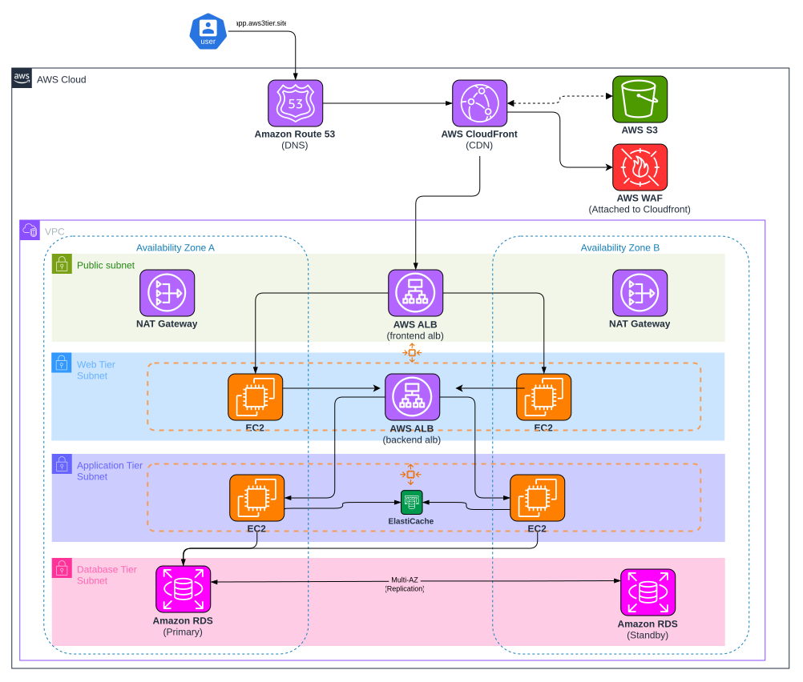

# Secure 3-Tier Web Application on AWS


This project uses Terraform to build a 3-tier web application infrastructure on AWS.
It separates the web, application, and database layers inside a VPC.

## Architecture



The main request flow is:

```text
User -> Route 53 -> CloudFront/WAF -> Public ALB
         -> Frontend Auto Scaling Group -> Internal ALB
         -> Backend Auto Scaling Group -> RDS and ElastiCache
```

The project also uses an S3 bucket for static files. CloudFront reads those files
through an Origin Access Control.

## What Terraform Creates

- A VPC in two Availability Zones.
- Public, private, and database subnets.
- Internet Gateway, NAT Gateways, route tables, and network ACLs.
- Security groups for the ALBs, EC2 instances, RDS, and ElastiCache.
- A public ALB for frontend traffic.
- An internal ALB for backend traffic.
- Frontend and backend Auto Scaling Groups with EC2 launch templates.
- Amazon RDS for MySQL 8.0 with Multi-AZ enabled.
- Amazon ElastiCache for Redis.
- An S3 bucket for frontend static content.
- CloudFront and AWS WAF for public traffic.
- ACM certificate validation through Route 53 DNS records.
- Route 53 DNS records for the application.
- IAM role and instance profile for Systems Manager access.

## Environments

### AWS DEV

`environments/AWS-DEV` contains the AWS deployment. It uses an S3 backend and
creates the complete application stack.

Before applying it, check the AWS account, domain name, ACM certificate settings,
AMI ID, and the IAM policy in [iam_policy.json](iam_policy.json).

```bash
cd environments/AWS-DEV
terraform init
terraform validate
terraform plan
terraform apply
```

The default region is `us-east-1` and the default domain is `aws3tier.site`.
Change the values with a `.tfvars` file or command-line variables when needed.

### LocalStack DEV

`environments/LocalStack-DEV` is a small LocalStack configuration. It currently
loads the VPC module and uses LocalStack service endpoints at `10.147.20.85:4566`.
It is not equivalent to the complete AWS DEV environment.

```bash
cd environments/LocalStack-DEV
terraform init
terraform validate
terraform plan
terraform apply
```

Make sure LocalStack is running and reachable before using this environment.

## Folder Structure

```text
.
├── environments/
│   ├── AWS-DEV/          # Full AWS deployment
│   └── LocalStack-DEV/   # LocalStack VPC test environment
├── global/               # Terraform state bucket resources
├── modules/
│   ├── asg/              # Frontend and backend Auto Scaling Groups
│   ├── cloudfront/       # CloudFront distribution and OAC
│   ├── elasticache/      # Redis cache
│   ├── elb/              # Public and internal ALBs
│   ├── rds/              # MySQL database
│   ├── route53/          # DNS records
│   ├── s3_static/        # Static content bucket
│   ├── vpc/              # VPC and security groups
│   └── waf/              # CloudFront WAF
├── scripts/              # EC2 user-data scripts
├── assets/               # Architecture diagram
└── iam_policy.json       # Terraform deployment IAM policy
```

## Important Notes

- The AWS environment can create paid resources, especially NAT Gateways,
    load balancers, RDS, ElastiCache, and CloudFront.
- The RDS password is generated by Terraform with `random_password`.
- Database deletion protection is enabled. Review this before destroying the
    environment.
- `terraform.tfstate` and plan files can contain sensitive information. Do not
    commit state files, plan files, passwords, or AWS credentials.
- The deployment policy is intentionally broad so Terraform can manage the full
    stack. For production, reduce permissions and scope resources by ARN.
- The frontend and backend user-data scripts expect the application software and
    configuration used by this project.

## Cleanup

Run this from the same environment directory that was deployed:

```bash
terraform destroy
```

Review the plan carefully. Some resources have deletion protection or lifecycle
settings that can prevent automatic deletion.
